# AWS Aurora PostgreSQL Migration Blueprint

> **DRAFT** · for team review. Source of truth for the interactive page and the slide deck.

How we move the application databases from AWS RDS Oracle to AWS Aurora PostgreSQL while development, testing and releases continue on today's environments, and how we prove the new database before switching production.

## Contents

1. [Purpose and objectives](#1-purpose-and-objectives)
2. [Proposed decisions for the team](#2-proposed-decisions-for-the-team)
3. [Why this approach, phase by phase](#3-why-this-approach-phase-by-phase)
4. [Alternatives compared](#4-alternatives-compared)
5. [Environments: Oracle side and PG side](#5-environments-oracle-side-and-pg-side)
6. [Architecture of one environment](#6-architecture-of-one-environment)
7. [One request, both sides](#7-one-request-both-sides)
8. [Inside the build and the config folders](#8-inside-the-build-and-the-config-folders)
9. [What changes in code](#9-what-changes-in-code)
10. [Pipeline and promotion](#10-pipeline-and-promotion)
11. [New infrastructure per PG-side environment](#11-new-infrastructure-per-pg-side-environment)
12. [Rollout, as planned](#12-rollout-as-planned)
13. [Performance testing in PVT: two test types](#13-performance-testing-in-pvt-two-test-types)
14. [prod-pg early: real traffic through the shadow mirror](#14-prod-pg-early-real-traffic-through-the-shadow-mirror)
15. [Data migration and sync](#15-data-migration-and-sync)
16. [Integrations per side](#16-integrations-per-side)
17. [Non-functional and compliance](#17-non-functional-and-compliance)
18. [Future items to address](#18-future-items-to-address)
19. [Watch list](#19-watch-list)

## 1. Purpose and objectives

### Background

The application already runs on AWS: about 15 modules, deployed as about 35 services per environment, each module behind its own context path. Every environment (dev, sit, test, pvt, prod) has its own cluster, VIP and AWS RDS Oracle database. The databases are moving to AWS Aurora PostgreSQL. The migration runs alongside normal delivery: planned stories keep being built, tested and released throughout.

**Business drivers:** the move follows an enterprise direction to reduce database cost. The working assumption is that AWS Aurora PostgreSQL costs less than AWS RDS Oracle, mainly because it carries no Oracle licence cost; this has not yet been measured and will be confirmed by comparing current and projected spend, including the one-time migration cost, and measured under real load during the prod-pg shadow month. PostgreSQL compatibility also reduces dependence on Oracle-specific features and licensing, although Aurora itself remains an AWS service.

### Objectives

- **Move every module's data** from AWS RDS Oracle to AWS Aurora PostgreSQL, with no data loss and no loss of functionality.
- **Keep delivering.** No feature freeze: planned stories ship on the current environments during the whole migration.
- **No risk to what runs today.** Existing environments, code and configuration stay unchanged until cutover.
- **Prove before switching.** Show the PG side gives the same results, the same data and acceptable performance, environment by environment.
- **Make cutover and rollback simple,** rehearsed in advance, with the Oracle side kept as a fallback.
- **Minimise code change** and leave nothing to undo afterwards: one codebase, one build, no long-lived branch.
- **One way of working** for all modules and teams: same terms, same naming, same pipeline steps.

### Scope

What the migration covers  
All application modules and their database schemas; JPA repositories and MyBatis mappers; environments dev, sit, test, pvt and prod; pipelines; PG-side infrastructure; schema conversion and data migration (AWS SCT, AWS DMS); cutover and retirement of the Oracle side.

New functionality during the migration  
Still delivered as planned. Each story is built once and must work on both databases: any new Oracle-specific SQL gets its PostgreSQL copy under `pg/`, and CI runs the tests on both.

### Guiding principles

- **Same build everywhere:** the image tested on the PG side is the image that runs on the Oracle side.
- **Additive, never in place:** new environments next to existing ones; nothing existing is modified.
- **Configuration over code:** the config folder decides the database; code changes only where SQL is Oracle-specific.
- **Proven on both databases:** every change is tested on AWS RDS Oracle and AWS Aurora PostgreSQL.
- **Reversible at every step,** including after the production switch.

### Success criteria

- All modules run in production on AWS Aurora PostgreSQL
- Data validated: row counts and values match for every table at cutover
- Performance on the PG side within the agreed threshold of today's
- No severity 1–2 incident caused by the migration
- Planned stories delivered on schedule during the migration
- Oracle-side environments and Oracle-specific files retired

### The approach in brief

Every environment gets a matching environment on the **PG side** (for example `sit` and `sit-pg`): fully separate, set up the same way, running the **same build** against AWS Aurora PostgreSQL. The **Oracle side** environments stay exactly as they are, so planned stories keep shipping to them while the PG side is converted and tested next to them. Production switches only after the PG side has been proven in every environment, and can switch back.

Environment  
One deployable target with its own VIP, cluster, config folder and database: `dev`, `sit`, `test`, `pvt-blue`, `prod-green`, `sit-pg`…

Oracle side  
The existing environments, on **AWS RDS Oracle**.

PG side  
The new `-pg` environments, on **AWS Aurora PostgreSQL (pg)**. Name = environment name + `-pg`.

## 2. Proposed decisions for the team

Recommended choices for the team to review and agree. Each one is backed by the reasoning and the alternatives compared in the next two sections; once agreed, they go into the architecture decision record.

1.  **One codebase, one build**: No Git branch for PostgreSQL. The same image is deployed to both sides of every environment.
2.  **No Spring profiles**: Each deployment reads its own config folder (`sit` or `sit-pg`). The folder decides the database.
3.  **Separate PG-side environments**: New ECS cluster and ALB for each `*-pg` environment. Nothing is added to the existing clusters or ALBs.
4.  **Same context paths**: Every module keeps its `/<context>`. Only the VIP differs: `sit.oc.awslab.uspto.gov` vs `sit-pg.oc.awslab.uspto.gov`.
5.  **Existing code untouched**: Services, entities and Oracle mapper files stay as they are. PostgreSQL SQL is added in new files under `pg/`.
6.  **Fix only what's Oracle-specific**: Scan repositories for native SQL and Oracle functions; rewrite those methods portably, verified on Oracle first.

## 3. Why this approach, phase by phase

What the team gains at each step, compared with doing the migration any other way.

### Development

- **One branch, one codebase.** Planned stories and migration work go into the same code; nothing is built twice or merged later.
- **Existing code stays untouched.** Services, entities and Oracle mapper files don't change, so ongoing Oracle work carries no new regression risk.
- **Small, measurable change surface.** The scan lists every Oracle-specific repository method; the parity check lists every mapper still missing its `pg/` copy.
- **Every merge request proves both databases.** The same tests run on AWS RDS Oracle and AWS Aurora PostgreSQL in CI.

### Pipeline

- **One artifact.** The image tested on the PG side is the exact image that runs on the Oracle side.
- **One extra deploy step per environment,** not a second pipeline. Only the config folder differs.
- **Built-in gates:** Oracle-specific SQL scan, mapper parity and tests on both databases stop problems at merge time.
- **Both sides always on the same version,** so results stay comparable while stories keep shipping.

### Deployment

- **Purely additive.** New clusters, ALBs, VIPs and config folders; existing environments, ALB rules and certificates are not modified.
- **Simple change requests.** "Nothing existing is changed; remove by deleting the new environment."
- **Same context paths.** Only the VIP differs, so client configs and Postman collections switch by host name.
- **Same Terraform module** builds both sides, so PG-side environments can't drift from Oracle-side ones.

### Testing

- **Compared where the data is the same.** Right after a DMS load, records that existed at load time can be compared on both sides. After that, lab environments drift apart, so new workflows are tested on each side on their own. Full like-for-like comparison comes from the mirrored PT (same snapshot) and the prod-pg shadow month (kept current by CDC).
- **No disruption to normal testing.** sit, test and pvt keep running on the Oracle side for planned releases.
- **Real performance comparison:** a read-only PT mirrored to pvt and pvt-pg at once, plus a full PT on pvt-pg alone.
- **Real users before cutover:** prod read traffic mirrored to prod-pg for at least a month.
- **Clear results:** /actuator/info and the VIP name show which side answered.

### Cutover and rollback

- **Rehearsed before prod:** sync, sequence reset and switch are practised in test-pg and pvt-pg.
- **Cutover is a switch,** not a deployment: point the prod VIP at prod-pg.
- **Rollback is a switch back.** The Oracle side stays intact, with reverse DMS keeping it current during the rollback window.

### After the migration

- **Clean retirement:** remove the Oracle-side environments and the Oracle mapper files; no application code needs rewriting.
- **Nothing left half-done:** no long-lived branch to merge, no feature flags or dual-write code to remove.

**The trade-off:** running PG-side environments in parallel costs extra infrastructure while the migration lasts. Keep it down by creating the PG side one environment at a time, using fewer and smaller tasks in dev-pg and sit-pg, scaling them down outside working hours, and sizing prod-pg for read-only shadow traffic until cutover.

## 4. Alternatives compared

The options usually considered for moving a live system to a new database while development continues, ranked from most to least recommended.

| Rank | Approach                                                                                        | Risk to ongoing Oracle work                                                                      | Maintenance during migration                                            | Testing confidence                                                                                            | Rollback                                                  | Extra cost                                                      |
|------|-------------------------------------------------------------------------------------------------|--------------------------------------------------------------------------------------------------|-------------------------------------------------------------------------|---------------------------------------------------------------------------------------------------------------|-----------------------------------------------------------|-----------------------------------------------------------------|
| 1    | **Chosen:** same build, separate PG-side environments, config folders · Verified: dev-pg sample | **Low** additive only; existing code and environments untouched                                  | **Low** one branch; parity check keeps mapper copies in step            | **High** same build tested on both databases; like-for-like on loaded data, mirrored PT and real prod traffic | **Easy** switch the VIP back; Oracle side intact          | **Medium** parallel environments, reduced by phasing and sizing |
| 2    | **Spring profiles** with `@Profile` beans and profile property files                            | **Low–medium** touches existing classes and the config structure                                 | **Medium** profile files and annotations to manage across modules       | **High**                                                                                                      | **Easy**                                                  | **Same as chosen**                                              |
| 3    | **PG services inside existing clusters and ALBs** (header or path routing on the same VIP)      | **Medium** changes to shared ALB rules and clusters; shared capacity                             | **Medium** routing rules to keep correct per module                     | **Medium** easy to hit the wrong side by mistake                                                              | **Easy**                                                  | **Low**                                                         |
| 4    | **Separate Git branch** for PostgreSQL                                                          | **Medium** large merge at the end                                                                | **High** every story made twice for the whole migration; branches drift | **Medium** the PG build is not the code running in prod                                                       | **Medium** redeploy a different build                     | **Low**                                                         |
| 5    | **In-place switch** of each environment (no parallel environments)                              | **High** once switched, that environment is no longer available for Oracle releases and hotfixes | **Low**                                                                 | **Low** no side-by-side comparison; differences found by users or testers later                               | **Hard** data written after the switch must be moved back | **Lowest**                                                      |
| 6    | **Dual-write** from the application to both databases                                           | **High** new write logic in every service                                                        | **High** consistency handling, retries, conflict cases                  | **Medium** data can diverge silently                                                                          | **Medium** extra code to remove afterwards                | **Medium**                                                      |

Why the chosen approach ranks first: it is the only option that keeps every existing environment and file untouched, tests the same build on both databases in every environment, with like-for-like comparison where the data is the same (after each load, in the mirrored PT and the prod-pg shadow month), and makes both cutover and rollback a switch rather than a deployment. Its one extra cost, parallel infrastructure, is temporary and controllable.

## 5. Environments: Oracle side and PG side

Each environment keeps its Oracle side and gains a PG side with the same ~35 services. Naming rule: **PG-side environment = environment name + `-pg`**, used the same way for VIPs, clusters, config folders and pipeline stages. VIP names below follow the `<env>.oc.awslab.uspto.gov` pattern (prod: `.oc.aws.uspto.gov`); the PG side adds `-pg` to the environment name. AWS DMS loads each PG-side environment from its Oracle side: a full load in the lab environments, and full load plus continuous sync (CDC) for prod.

| Environment | Oracle side · existing                                                                                                                             | DMS            | PG side · new                                                                                                                              |
|-------------|----------------------------------------------------------------------------------------------------------------------------------------------------|----------------|--------------------------------------------------------------------------------------------------------------------------------------------|
| **DEV**     | vip: `dev.oc.awslab.uspto.gov` · cluster: dev · config: config/dev/ · db: AWS RDS Oracle (dev)                                                     | DMS full load  | vip: `dev-pg.oc.awslab.uspto.gov` · cluster: dev-pg · config: config/dev-pg/ · db: AWS Aurora PostgreSQL (dev)                             |
| **SIT**     | vip: `sit.oc.awslab.uspto.gov` · cluster: sit · config: config/sit/ · db: AWS RDS Oracle (sit)                                                     | DMS full load  | vip: `sit-pg.oc.awslab.uspto.gov` · cluster: sit-pg · config: config/sit-pg/ · db: AWS Aurora PostgreSQL (sit)                             |
| **TEST**    | vip: `test.oc.awslab.uspto.gov` · cluster: test · config: config/test/ · db: AWS RDS Oracle (test)                                                 | DMS full load  | vip: `test-pg.oc.awslab.uspto.gov` · cluster: test-pg · config: config/test-pg/ · db: AWS Aurora PostgreSQL (test)                         |
| **PVT**     | vip: `pvt-blue.oc.awslab.uspto.gov / pvt-green.oc.awslab.uspto.gov` · cluster: pvt (blue / green) · config: config/pvt/ · db: AWS RDS Oracle (pvt) | DMS full load  | vip: `pvt-pg.oc.awslab.uspto.gov` · cluster: pvt-pg · config: config/pvt-pg/ · db: AWS Aurora PostgreSQL (pvt)                             |
| **PROD**    | vip: `prod-blue.oc.aws.uspto.gov / prod-green.oc.aws.uspto.gov` · cluster: prod (blue / green) · config: config/prod/ · db: AWS RDS Oracle (prod)  | DMS load + CDC | vip: `prod-pg.oc.aws.uspto.gov / (internal until cutover)` · cluster: prod-pg · config: config/prod-pg/ · db: AWS Aurora PostgreSQL (prod) |

## 6. Architecture of one environment

Shown for `sit` and `sit-pg`; every environment follows the same pattern. The middle column says what the two sides share and what each keeps to itself. Integrations are shown generically; replace them with the module's real list.



AWS resources for `sit` and `sit-pg`; every environment repeats this pattern. Solid coloured lines: each side's services reach their own SQS queues, Amazon MQ broker and database, and the same EFS and S3. Each side has its own Lambda functions, which call that side's VIP. Dashed: shared ACM certificate and ECR image. The shadow mirror path exists only in pvt and prod. Secrets Manager, security groups and IAM roles are per side and not drawn.

### Resource by resource

|                   | Oracle side · sit                            | Between the sides             | PG side · sit-pg                                    |
|-------------------|----------------------------------------------|-------------------------------|-----------------------------------------------------|
| **Entry**         | sit.oc.awslab.uspto.gov → ALB                | separate                      | sit-pg.oc.awslab.uspto.gov → ALB                    |
| **Compute**       | ECS cluster sit · ~35 services · config/sit/ | same image                    | ECS cluster sit-pg · ~35 services · config/sit-pg/  |
| **Database**      | AWS RDS Oracle                               | DMS load →                    | AWS Aurora PostgreSQL                               |
| **Documents**     | EFS mount                                    | same file system · both sides | Same EFS: read and write                            |
| **Objects**       | S3 buckets                                   | same buckets · both sides     | Same S3 buckets: read and write                     |
| **Functions**     | Lambda functions calling sit services        | separate · same code          | Own Lambda functions calling sit-pg VIP             |
| **Messaging**     | SQS queues; Amazon MQ broker                 | separate                      | Own SQS queues and own Amazon MQ queues (or broker) |
| **External**      | External services, callbacks                 | separate                      | Test endpoint or stub; callbacks to the -pg VIP     |
| **Observability** | Splunk, CloudWatch                           | shared, tagged by side        | Splunk, CloudWatch (db=pg)                          |

Rule of thumb: documents and objects live in the **same EFS and S3** for both sides; messages and external calls from the PG side go to its **own queues or stubs**.

## 7. One request, both sides

The two host names reach two separate running copies of the same application. Inside each copy the code path is identical. What differs was decided once, when that copy started.

| Step    | `PUT sit.oc.awslab.uspto.gov/<context>/some-endpoint`                       | `PUT sit-pg.oc.awslab.uspto.gov/<context>/some-endpoint`                         |
|---------|-----------------------------------------------------------------------------|----------------------------------------------------------------------------------|
| routing | ALB `sit`: rule `/<context>*` → module service                              | ALB `sit-pg`: rule `/<context>*` → module service                                |
| startup | Started with `config/sit/`: Oracle URL, pool, mapper XML next to interfaces | Started with `config/sit-pg/`: AWS Aurora PostgreSQL URL, pool, `pg/` mapper XML |
| same    | `SomeController.someEndpoint()`                                             | `SomeController.someEndpoint()`                                                  |
| same    | `SomeService.update()`                                                      | `SomeService.update()`                                                           |
| same    | `someRepository.findById()` · entity change · commit                        | `someRepository.findById()` · entity change · commit                             |
| SQL     | Hibernate / MyBatis send Oracle SQL · `select some_seq.nextval from dual`   | Hibernate / MyBatis send PostgreSQL SQL · `select nextval('some_seq')`           |
|         | AWS RDS Oracle (sit)                                                        | AWS Aurora PostgreSQL (sit)                                                      |

Only three points differ: the ALB that receives the request, the config folder the service started with, and the SQL generated for the database it is connected to. Controllers, services, entities and repositories are the same code.

## 8. Inside the build and the config folders

### The JAR (one build)

``` text
src/main/java/gov/uspto/pe2e/oc/<module>/
  web/ service/ domain/ repository/    unchanged
  mapper/SomeMapper.java                unchanged
src/main/resources/
  application.properties                common, unchanged
  gov/uspto/pe2e/oc/<module>/mapper/SomeMapper.xml     Oracle, unchanged
  pg/gov/uspto/pe2e/oc/<module>/mapper/SomeMapper.xml  new
```

Oracle deployments never read `pg/`: MyBatis loads the XML next to each interface, as today. PostgreSQL copies keep the same namespace and statement ids.

### Config folder per deployment

``` text
config/sit/                      existing
  logback.xml
  app-specific.properties        Oracle URL, creds, pool
config/sit-pg/                   new
  logback.xml
  app-specific.properties        AWS Aurora PostgreSQL URL, creds, pool,
                                  mapper location, PG service URLs
```

``` properties
spring.datasource.url=jdbc:postgresql://<module>-sit.cluster-…:5432/<db>
spring.datasource.hikari.maximum-pool-size=20
mybatis.mapper-locations=classpath*:pg/**/*.xml   # only in *-pg
other-module.base-url=https://sit-pg.oc.awslab.uspto.gov/other-module   # stay on the PG side
```

## 9. What changes in code

| Area                                                   | Change                                                                                                                                   | Effort         |
|--------------------------------------------------------|------------------------------------------------------------------------------------------------------------------------------------------|----------------|
| Controllers, services (~100)                           | None. Business logic doesn't depend on the database.                                                                                     | none           |
| Entities (~300)                                        | None. Sequences work on both as long as the PostgreSQL sequences exist with the same name and increment.                                 | none           |
| Repositories: derived queries, portable JPQL (~250)    | None. Hibernate writes the SQL for each database.                                                                                        | none           |
| Repository methods with native SQL or Oracle functions | Rewrite as JPQL or a derived query behind the same method name, or move the SQL to a mapper with a `pg/` copy. Verified on Oracle first. | scan hits only |
| MyBatis mapper XML                                     | A PostgreSQL copy per file under `pg/`, same namespace and ids; convert only the statements that differ.                                 | new files      |
| JdbcTemplate / hand-written SQL classes                | Not used in this codebase, so nothing to do.                                                                                             | none           |

### Details by area

### Repositories: JPQL and derived queries

- **Replace Oracle functions:** `nvl` → `coalesce`, `trunc` → `cast(… as LocalDate)`, `decode` → `case`, `to_char` / `to_date` → `extract` / `cast`, `sysdate` → `current_timestamp`, any `function('…')`.
- **Unchanged on both:** derived queries, `Pageable` / `Limit`, joins, constructor expressions, `@Modifying`, `@Lock`, `@Version`, Specifications.

### Repositories: native SQL

- **Portable rewrite** (JPQL or derived query) behind the **same method name**, verified on Oracle first; for example `ROWNUM` → `Limit`.
- **Not portable:** a repository fragment whose implementation calls a MyBatis mapper, SQL in `mapper/` and `pg/mapper/`. Services don't change.
- **Stored procedures** (`@Procedure`): the PostgreSQL function must exist with the same name and signature.

### Entities

- **IDs:** `@SequenceGenerator` works unchanged if the sequence exists with the **same name** and **INCREMENT BY = allocationSize**. Also check `AUTO` (`<entity>_SEQ`, increment 50), `IDENTITY`, and IDs filled by Oracle triggers.
- **Check:** `@Formula`, `@SQLRestriction` / `@Where`, `columnDefinition`, `@Lob`, quoted table names, a hard-coded Oracle dialect.

### MyBatis

- **XML next to the interface** stays as it is (Oracle). The PostgreSQL copy goes under `pg/…`, loaded only through `mybatis.mapper-locations` in `*-pg` config.
- **SQL in annotations** (`@Select`, …) has no file to swap: move Oracle-specific statements into XML.
- **Avoid `Map<String,Object>` results:** Oracle returns UPPERCASE column keys.

### Same SQL, different results

- Integer division (PostgreSQL truncates), `''` vs `NULL`, sort order and collation, timestamps and time zones, stricter type checks.
- A scan can't find these; only tests on PostgreSQL and the shadow mirror's comparisons do.

### Schema settings

- No schema names in code is fine.
- If objects aren't in the app user's default schema, set `currentSchema` in the JDBC URL or the role's `search_path`.

### How it's verified: three layers

1.  **Scan the code**: The Oracle-specific SQL scan lists every native query, Oracle function and entity annotation to review.
2.  **Validate at startup**: `spring.jpa.hibernate.ddl-auto=validate` in `*-pg` config only: all entities are checked against the PostgreSQL schema (tables, columns, sequences) and every JPQL query is parsed.
3.  **Test on both**: The same tests on AWS RDS Oracle and AWS Aurora PostgreSQL in CI, plus the mapper parity check.

## 10. Pipeline and promotion

The same branch model as today. Each build is deployed to both sides of its environments, so the Oracle side and the PG side always run the same version.

- **develop branch** → build + tests on both databases → dev + dev-pg and sit + sit-pg (in parallel)
- **release branch · tag** → build + tests on both databases → test + test-pg and pvt + pvt-pg (in parallel · PVT = performance testing)
- then the same tag → **prod (+ prod-pg )**

| Source             | Deployed to                                                   | Gate                                                    |
|--------------------|---------------------------------------------------------------|---------------------------------------------------------|
| develop branch     | dev + dev-pg and sit + sit-pg, at the same time               | Tests green on both databases; both sides healthy       |
| release branch tag | test + test-pg and pvt + pvt-pg, at the same time (one image) | Business tests and performance tests pass on both sides |
| same release tag   | prod, and prod-pg (shadow, then cutover)                      | test, test-pg, pvt and pvt-pg all pass                  |

Gates on every merge request: Oracle-specific SQL scan, mapper parity check, the same tests on AWS RDS Oracle and AWS Aurora PostgreSQL.

## 11. New infrastructure per PG-side environment

All additive: nothing existing is modified, and each PG-side environment can be removed by deleting it. Built from the same Terraform module as the Oracle side.

- AWS Aurora PostgreSQL cluster, schema converted with AWS SCT
- DMS task from that environment's Oracle: full load for lab environments, full load + CDC for prod; sequences set after each load
- ECS cluster `<env>-pg` with all ~35 services, same images
- PG-side copies of the Lambda functions, pointing at the `-pg` VIP and PG-side queues
- Task definitions pointing at `config/<env>-pg/`
- ALB with one rule per context path, same priorities; target groups and health checks
- DNS CNAME `<env>-pg.oc.awslab.uspto.gov` (prod: `prod-pg.oc.aws.uspto.gov`) → the new ALB
- One new ACM certificate listing all PG VIP names (dev-pg, sit-pg, test-pg, pvt-pg, prod-pg)
- Security groups: PG-side services reach AWS Aurora PostgreSQL only, never AWS RDS Oracle
- Firewall, allowlist and WAF entries for the new VIPs
- Secrets for AWS Aurora PostgreSQL credentials; log groups, dashboards and alarms tagged `db=pg`

## 12. Rollout, as planned

The phases follow the branch model: develop feeds dev and sit, a release tag feeds test, pvt and prod.

| Phase                    | Environments               | What happens                                                                                                                                                                                                                             |
|--------------------------|----------------------------|------------------------------------------------------------------------------------------------------------------------------------------------------------------------------------------------------------------------------------------|
| Phase 1 · develop branch | **dev-pg + sit-pg**        | **Done:** dev-pg sample verified the flow end to end. Next: all modules on dev-pg, then sit-pg; AWS Aurora PostgreSQL and DMS loads; repository scan and fixes; `pg/` mappers; CI on both databases; integration testing on the PG side. |
| Phase 2 · release tag    | **test-pg + pvt-pg**       | Business testing on test-pg; two performance tests: read-only with the shadow mirror (pvt and pvt-pg), then a full PT on pvt-pg alone; cutover and rollback rehearsals.                                                                  |
| Phase 3 · release tag    | **prod-pg in shadow mode** | Built early; DMS CDC from prod; real read traffic mirrored for at least a month; measured cost, latency and correctness. Can start during phase 2.                                                                                       |
| Cutover                  | **Switch prod**            | Go/no-go met; final CDC sync; sequences set; prod VIP → prod-pg; reverse DMS kept for rollback.                                                                                                                                          |
| After                    | **Retire Oracle**          | Remove Oracle-side environments; delete Oracle mapper files and drivers.                                                                                                                                                                 |

## 13. Performance testing in PVT: two test types

Two separate PT runs, each answering a different question. Together they cover reads under identical load and the full workload, including writes, on AWS Aurora PostgreSQL.

*PT 1 · read-only, mirrored*

### One run, two results

**Load generator** (read-only scenario) → **pvt** (AWS RDS Oracle) copies → **pvt-pg** (receiver)

- **Question:** for the same requests at the same moment, how do response times and results compare?
- **Setup:** pvt sends copies with `shadow.enabled=true`, `sample-rate=1.0`, `target-url=https://pvt-pg.oc.awslab.uspto.gov/<context>`; pvt-pg runs with `shadow.receiver=true`. pvt-pg has its own VIP, so no ALB rule is needed.
- **Data:** both loaded from the same snapshot; read-only, so nothing drifts.
- **Compare in Splunk:** p50 / p95 / p99 per endpoint, throughput, errors, `shadow.result` match / mismatch, database load (RDS Oracle vs Aurora).
- **Caution:** run a short baseline without the mirror first, to see the mirror's own overhead on pvt.

*PT 2 · full, PG only*

### The complete workload on AWS Aurora PostgreSQL

**Load generator** (full scenario) → **pvt-pg** (AWS Aurora PostgreSQL) · **mirror off**

- **Question:** can the PG side carry the full production-like workload, reads and writes, at peak volume?
- **Setup:** the normal PT suite pointed at `pvt-pg.oc.awslab.uspto.gov`; no mirror (`shadow.enabled=false` on pvt).
- **Data:** writes are allowed; reload pvt-pg and set sequences again after the run.
- **Compare:** against the latest full PT results of pvt-blue / pvt-green (same scenario, same volume): response times, throughput, errors, Aurora CPU, I/O and connections.
- **Also covers:** write paths, batch jobs, sequence and locking behaviour, connection pool sizing.

## 14. prod-pg early: real traffic through the shadow mirror

prod-pg is built before cutover and receives a copy of real production read traffic for at least a month. Users are always answered by the Oracle side; the copy runs in the background.

**Users** → **prod (Oracle side)** (prod-blue / prod-green · AWS RDS Oracle) copies → reads only **prod-pg (receiver)** (AWS Aurora PostgreSQL) ← **DMS CDC** (keeps prod-pg current)

- **5%**: first week
- **25%**: after checks
- **100%**: rest of the month
- **Off switch**: `shadow.enabled=false` + restart, at any time

### What a month gives us

- **Measured cost** of AWS Aurora PostgreSQL under prod load, including I/O: replaces the cost assumption with real numbers
- **Response times and throughput** on real traffic, including month-end and peak days
- **Correctness** on real queries: mismatch rate trending to zero
- **Operational readiness**: monitoring, alarms and on-call practised before cutover

### Conditions

- prod-pg has prod-level **security approval** before it receives any prod data
- Integrations isolated: mirrored reads trigger no SQS or Amazon MQ sends, or external calls
- Writes are not mirrored: they are proven by the full PT on pvt-pg and the cutover rehearsals

### Exit criteria

- Mismatch rate, latency and measured cost within agreed thresholds; zero user impact. These feed the go / no-go.

## 15. Data migration and sync

The application side is mostly configuration. The data side is the critical path: plan it explicitly.

### Input for the database team: what AWS SCT assesses

AWS SCT (Schema Conversion Tool) reads the Oracle schema of each environment and reports what converts to PostgreSQL automatically and what needs manual work. It covers the database objects themselves, not application code:

- Tables, constraints, indexes, **sequences** (name, increment, current value)
- Views and materialized views
- PL/SQL packages, procedures, functions, **triggers**
- Scheduled jobs (`DBMS_SCHEDULER` / `DBMS_JOB`)
- Synonyms, DB links, grants and roles
- Character set, time zone, NLS settings

AWS SCT converts much of this automatically; its assessment report lists what needs manual work. Run it early.

### Database server layout

- No other applications or tools use these databases.
- Lab environments share one AWS RDS Oracle server, with a separate database user per environment (dev, sit, test, pvt); prod has its own.
- PG side, for the database team to decide: the same pattern (one shared Aurora cluster for the lab environments, one database and user per environment) or a cluster per environment. The application only sees a JDBC URL and user in `*-pg` config, so either works.

### DMS points to check

- CDC needs a primary key (or unique key) on every replicated table
- LOB columns need the right LOB mode and size limits
- Sequence positions are not replicated: set them after every load (see below)
- Disable PostgreSQL triggers and FK checks on replicated tables during load, re-enable after
- Use DMS data validation (row counts and value checks) per table

### Data, documents and sequences

Documents live outside the database (EFS and S3), and document keys can come from sequence IDs. DMS copies rows, not files and not sequence positions, so documents and sequences are decided together.

### Lab environments: snapshot model

- **Database:** one DMS full load from the matching Oracle side, then **no CDC**; the PG side lives independently and is refreshed on demand.
- **Sequences:** after each load, set every PG-side sequence to its **Oracle value + a large offset** (for example +10,000,000), same `INCREMENT BY`, so PG-side IDs never clash with IDs the Oracle side creates later.
- **Documents:** the **same EFS and S3** as the Oracle side, no new storage. The PG side reads existing documents and writes new ones to the same store; the sequence offset means a new document key can never clash with one the Oracle side creates.
- **One rule:** PG-side tests must not delete or overwrite existing documents, because the Oracle side still uses them.
- **What can be compared:** records that existed at load time give the same results on both sides. Once testers write on either side the data drifts, so new workflows are verified on each side on their own (does it work, are the results correct), not by comparing records.
- **On refresh:** reload and set sequences with the offset again. Documents created by PG-side tests stay in the store without a database row; they are easy to find (IDs above the offset) and can be cleaned up if needed.

### Prod: continuous sync until cutover

- **Database:** DMS full load + **CDC continuously**; no writes on prod-pg before cutover (shadow reads only).
- **Documents:** prod-pg reads the same prod EFS / S3, read-only, until cutover.
- **At cutover:** the Oracle side stops writing; sequences set to the Oracle values (no offset); prod-pg becomes the writer to the same document store.
- **Rollback:** reverse DMS brings rows back to Oracle; documents written after cutover are already in the shared store.

| Environment        | Load                 | Ongoing sync      | PG-side writes                                         | Sequences               | Documents (EFS / S3)                               | Refresh               |
|--------------------|----------------------|-------------------|--------------------------------------------------------|-------------------------|----------------------------------------------------|-----------------------|
| `dev-pg`, `sit-pg` | DMS full load        | None              | Allowed                                                | Oracle value + offset   | Same store: read and write; no deletes of existing | On demand / per cycle |
| `test-pg`          | DMS full load        | None              | Allowed                                                | Oracle value + offset   | Same store: read and write; no deletes of existing | Per release           |
| `pvt-pg`           | Same snapshot as pvt | None              | None in mirrored PT; allowed in full PT (reload after) | Oracle value + offset   | Same store: read and write; no deletes of existing | Before each PT run    |
| `prod-pg`          | DMS full load        | CDC until cutover | **None** before cutover                                | Oracle value at cutover | Same store, read-only until cutover                | —                     |

``` sql
-- Oracle: list sequences
SELECT sequence_name, last_number, increment_by FROM user_sequences;
-- PostgreSQL (lab), for each sequence after a load:
SELECT setval('some_seq', <last_number> + 10000000);
```

## 16. Integrations per side

A PG-side environment must not trigger real side effects, or have its messages consumed by Oracle-side services. Every integration endpoint gets its own value in the `*-pg` config folder, or a stub.

| Integration                                | Risk if shared                                                                                                                                                   | PG-side setting                                                                                                                                                                                                                  |
|--------------------------------------------|------------------------------------------------------------------------------------------------------------------------------------------------------------------|----------------------------------------------------------------------------------------------------------------------------------------------------------------------------------------------------------------------------------|
| Service-to-service calls                   | PG services call Oracle-side services; mixed results                                                                                                             | `-pg` VIP in every base URL                                                                                                                                                                                                      |
| Message queues and topics (SQS, Amazon MQ) | Oracle-side consumers process PG-side test messages, or the reverse                                                                                              | Separate SQS queues per side; separate Amazon MQ queues/topics (or a separate broker) per side. If Amazon MQ moves to SQS before cutover, only the `*-pg` config values change.                                                  |
| Email, SMS, notifications                  | Duplicate messages to real recipients                                                                                                                            | Stub or sandbox endpoint                                                                                                                                                                                                         |
| File and object storage                    | PG-side tests deleting or overwriting files the Oracle side uses                                                                                                 | Same EFS and S3; new keys can't clash (sequence offset); no deletes or overwrites of existing files                                                                                                                              |
| External partner APIs and callbacks        | Duplicate transactions; callbacks land on the wrong side                                                                                                         | Partner test endpoint or stub; callback URL on the `-pg` VIP                                                                                                                                                                     |
| Lambda functions                           | A Lambda calls Oracle-side services for PG-side events (or the reverse); a Lambda triggered by an S3 event in the shared buckets reacts to files from both sides | Deploy the same Lambda code per side with the `-pg` VIP (and PG queues or JDBC URL) in its settings. For S3-triggered Lambdas, agree how each side is triggered, since S3 allows only one notification per prefix and event type |
| Caches and schedulers                      | Shared cache keys or jobs running twice                                                                                                                          | Separate cache instance or key prefix; schedulers per side                                                                                                                                                                       |

## 17. Non-functional and compliance

- **Security authorization:** new environments and AWS Aurora PostgreSQL inside the system boundary (security plan and ATO updates)
- **Connection budget:** services × tasks × Hikari pool size must stay below Aurora's max connections, with headroom
- Aurora sizing, parameter group (time zone, `search_path`), maintenance windows
- Encryption at rest and in transit; IAM roles; secrets rotation
- Backups, point-in-time recovery and disaster recovery matching today's targets
- Performance Insights, CloudWatch alarms and dashboards per PG-side environment
- Cost plan: PG side created per phase, smaller in dev-pg and sit-pg, removed after retirement
- Architecture decision record: the agreed decisions and the alternatives on this page

## 18. Future items to address

Not decided in this blueprint. Each is picked up in the phase where it is needed, with the team that owns it.

| Item                                 | What it covers                                                                                                                                                                   | Needed by        | Owner                               |
|--------------------------------------|----------------------------------------------------------------------------------------------------------------------------------------------------------------------------------|------------------|-------------------------------------|
| **Cutover and rollback plan**        | Go / no-go criteria and thresholds; cutover runbook (final CDC sync, sequences, prod VIP to prod-pg); reverse DMS; rehearsals in test-pg and pvt-pg                              | Phase 2          | Application + database + operations |
| **Database team inputs**             | AWS SCT assessment of the Oracle schema; Aurora sizing and connection budget; PG-side server layout (shared lab cluster or one per environment); sequence script after each load | Phase 1          | Database team                       |
| **Integration inventory per module** | EFS and S3 locations, SQS queues, Amazon MQ queues and topics, Lambda functions and their triggers, external services and their test endpoints or stubs                          | Phase 1 (sit-pg) | Module teams                        |
| **Shadow mirror and dashboards**     | Mirror setup pvt to pvt-pg and prod to prod-pg; Splunk dashboards comparing both sides                                                                                           | Phase 2          | Application + operations            |
| **Security and compliance**          | Security authorization update; prod-level approval for prod-pg before the shadow month                                                                                           | Phase 3          | Security                            |
| **Cost comparison**                  | Current AWS RDS Oracle spend vs measured AWS Aurora PostgreSQL cost from the prod-pg shadow month                                                                                | Before cutover   | Finance + architecture              |
| **Architecture decision record**     | Record the proposed decisions once the team agrees them                                                                                                                          | After review     | Architecture                        |

## 19. Watch list

**Calls crossing sides**

Every service-to-service URL in `*-pg` folders must use the `-pg` VIP, or PG services call Oracle services.

**Missing `pg/` mapper copy**

MyBatis silently falls back to the Oracle XML next to the interface. The parity check catches it.

**Sequences after DMS**

DMS copies rows, not sequence positions. After every lab load, set each sequence to the Oracle value plus the offset; at cutover, to the exact Oracle value.

**Default schema**

Without schema names in code, set `currentSchema` in the JDBC URL or the role's `search_path` if objects aren't in the user's schema.

**Certificate names**

The existing certificate lists exact names; the `-pg` VIPs need the new certificate on the new ALBs.

**Different results, same SQL**

Integer division, `''` vs `NULL`, sort order. Only tests on PostgreSQL find these.

Oracle-side environments, existing config folders, existing ALBs and existing code stay as they are throughout. Everything for PostgreSQL is added next to them and can be removed independently.
